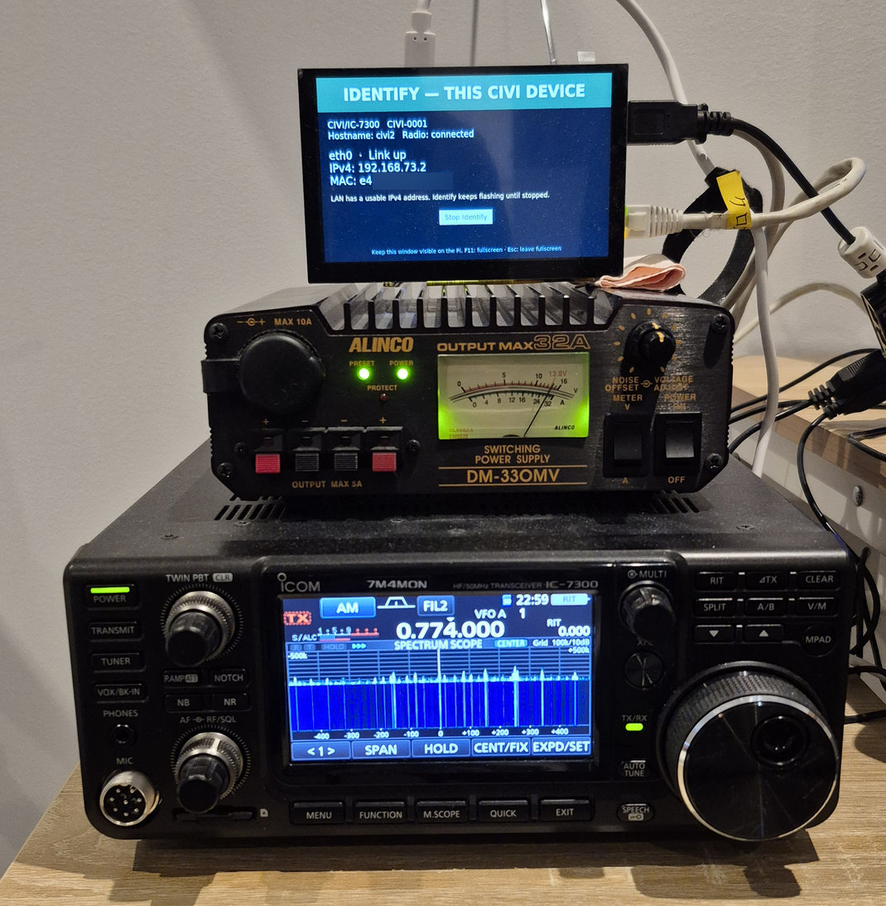

# CIVI

[English](README.md) | **日本語** · 作者: **7M4MON**

**Icom IC-7300をLAN経由で操作する計測器ゲートウェイ**です。無線機をWindowsまたはRaspberry Pi 4へUSB接続し、SCPI/VISA、英語Web画面、型付きPythonドライバー、LabVIEWから操作できます。TCPとHTTPSは単一のCI-V制御キューを共有します。

## 実装した機能

| 分野 | 実装内容 |
|---|---|
| SCPI / VISA | TCP 5025、LF終端、短縮形、単位、連続命令、エラーキュー、完了確認、受信プロファイルreset |
| 無線機制御 | VFO・周波数・モード、ゲイン、フィルター、メーター、メモリー、バンドスタック、キーヤー保存、スキャン、スコープ、メニュー、権限付き操作 |
| Pythonドライバー | **CIVIの拡張339コマンド定義すべてに専用の型付きAPIを実装**。基本命令も対応。公開・返却43型、コンストラクター等352項目を索引化 |
| Web | HTTPS、操作・設定認証、コマンドexplorer、475点スコープ、接続復旧、パスワード保存・変更 |
| Piネットワーク | DHCP/AutoIP/固定IPv4、ホスト名・DNS、保存・確定・ロールバック、重複IP保護、mDNS/DNS-SD、Ping制御 |
| 本体操作 | POWER ON、LAN NORMAL/FAULT、Identify点滅、LAN RESET、パスワード復旧、手動デスクトップ起動 |
| LabVIEW | VISAセッションAPI、読取・周波数/モード設定・CSV保存付き周波数スイープの使用例 |

**登録審査に向け、実装と実施済み試験の根拠を整理しました。** IVI登録済み・LXI/IVI正式適合の表示は行っていません。機能数はCIVIが文書化したコマンド定義の対応数です。

## 実施済み試験と結果

| 試験 | 結果 |
|---|---|
| 公開前の自動検証 | **619件成功・Linux専用1件スキップ**。ドライバー型検査・文書整合性6チェックも成功 |
| MAIN 1.41 Core・受信 | Core/受信40、受信設定65チェック、全216メニュー読取に成功 |
| MAIN 1.42 VFO API | 両VFO、周波数上下限、8モード、DATA・フィルター、交換・復元の57チェック成功 |
| メモリー書込・読戻し・消去 | 空99番を使用した24チェック成功、試験後は空へ復元 |
| 選択メモリー操作・VFOコピー | それぞれ29・23チェック成功、元の状態へ復元 |
| バンドスタック・キーヤー | 全33スロット・8テキストの書込・読戻し・復元、89チェック成功 |
| スコープ | 72チェック成功、475点波形、固定エッジ52件読取、14設定を復元 |
| スキャン | 全7開始種別を8回の実走行で確認、ΔF全7幅とALL/★1/★2/★3を確認 |
| MAIN 1.42 TX Inhibit | ON/OFF読戻し・不正型拒否を確認し元へ復元 |
| Pi有線LAN | DHCP取得・更新・失効・再取得、固定IP保存・再起動、AutoIP通信、LAN RESET・ケーブル復帰を確認 |
| 発見・本体表示 | 実名衝突、再起動時の名前保持、再接続時のプローブ・広告、LAN Fault・Identifyを確認 |
| Web・識別API | XML/スキーマ、認証、切断後の古い値消去、確定期限切れを確認。Windows・スマホChromeで表示確認 |

[**要求事項・実装・試験方法・結果の対応表（英語）**](docs/IMPLEMENTATION_AND_TEST_RESULTS.md)に日付付き記録をまとめています。各件数は個別試験の値であり、重複のない総件数としては合算しません。実機の設定変更試験は可能な箇所で読取・変更・読戻し・復元を行っています。

- [Pythonドライバー導入・使用例](drivers/civi-ic7300/README.md) · [公開API一覧](drivers/civi-ic7300/src/civi_ic7300/REFERENCE.md)
- [拡張339コマンドのAPI対応表](docs/PYTHON_DRIVER_COVERAGE.md) · [基本命令を含む統合一覧](docs/PYTHON_SCPI_AUDIT.md)
- [LabVIEWプロジェクトと使用例](labview/CIVI/README.md)
- [LXI全条項照合表](docs/LXI_REQUIREMENTS_2026-11-10.md)



## Windowsで起動

Python 3.11以上を用意し、PowerShellでこのフォルダーから実行します。

```powershell
python -m venv .venv
.\.venv\Scripts\python.exe -m pip install -e '.[test]'
Copy-Item config.example.toml config.toml
.\.venv\Scripts\python.exe -m civi --make-cert certs --host 192.168.1.20
.\start.cmd
```

`--host`には実際のLAN IPやDNS名を指定できます。localhostは自動で含まれます。自己署名証明書を生成します。利用する端末で証明書を確認して信頼するか、信頼されたCAの証明書と鍵をconfig.tomlに指定してください。秘密鍵は共有しないでください。既存証明書は上書きしません。

Webは `https://localhost:8443`、SCPIは `localhost:5025`。初期設定は模擬無線機なので実機がなくても操作できます。Webログインユーザーは `admin`、初回のパスワードは環境変数から指定し、Webで保存した認証設定がある場合はそちらを優先します。12文字以上が必要です。パスワードをソースやconfig.tomlには保存しません。

次回からはPowerShellで `.\start.cmd`、コマンドプロンプトで `start.cmd` を実行します。初回だけWebパスワードを非表示で入力し、WindowsのDPAPIで暗号化した資格情報を `.civi-password.xml` に保存します（Git対象外）。同じPCの同じWindowsアカウントでのみ復号でき、次回から保存値を設定済みのパスワード環境変数へ渡して起動します。`-ResetPassword`はこのDPAPI保存値を変更するランチャーのオプションです。後からWebで保存したパスワードがある場合は、その保存値が環境変数より優先します。Ctrl+Cで終了でき、自動起動は設定しません。`python -m civi`で直接起動する場合も、Webの保存値がなければ環境変数の設定が必要です。

`*IDN?`は`CIVI Project,CIVI/IC-7300,CIVI-0001,0.1.0`のようにCIVIと識別済みの接続機種を返します。未接続・未知の機種IDでは機種部分が`Unknown`になります。末尾はCIVIのソフトウェア版です。無線機のファームウェア版はWebの`Radio firmware`と`RAD:FIRM?`に分けて表示します。自動取得は行わず、未設定では`Unknown`、config.tomlトップレベルの`radio_firmware`に手動登録できます。

Web画面は英語です。無線機が未接続でもCIVIのWebサーバーを起動でき、ログイン前から`Waiting for radio`を表示します。COMポートが不在の場合は約2秒ごとに再試行します。ポートが開いても無線機が無応答の場合は、遅延応答の誤認を防ぐため`Radio not ready — recovery required`を表示します。電源・USB・CI-V設定を確認し、無線機とUSBリンクをリセットしてから、ログイン後の`CI-V connection settings` → 確認チェック → `Recover connection`で復旧してください。無線機未準備でも設定画面とSCPIコンソールは利用できます。

`ERR_CONNECTION_REFUSED`はWebサーバーに接続できていない状態です。CIVI自体が終了していると待機画面も配信できません。起動したPowerShellを開いたままにし、`Web is ready`の表示と起動エラーの有無を確認してください。更新したコードの反映にはCIVIの再起動とブラウザの再読み込みが必要です。

`bind = "0.0.0.0"`でlocalhostとLANから利用可能です。Windowsファイアウォールで必要な端末からのTCP 5025/8443と、発見に必要なUDP 5353を許可してください。localhost限定の場合は`127.0.0.1`に変更します。SCPIは仕様どおり平文・認証なしのTCPです。Webの認証はSCPIポートを保護しないため、SCPIはアクセスを制限したLANで使用します。

## Raspberry PiのWebパスワードと復旧

以下はこのブランチを`~/civi-rpi-lxi`へ置いた場合の例です。導入先に合わせてパスを変更してください。

### 初回起動と通常の変更

```bash
cd ~/civi-rpi-lxi
bash start.sh
```

保存済み認証設定もパスワード環境変数もない初回は、Webパスワードを非表示で入力します。ユーザー名は**admin**です。環境変数だけを使用する段階では、起動元のシェルに値を保持していなければ次回起動時にも入力します。

保存するには、Webの**LAN information / discovery settings → Change Web password**（`/network#web-password`）を開き、現在のパスワードと新しいパスワードを2回入力します。新しい値は12–256文字です。即時反映し、`.civi-web-auth.json`へソルト付きハッシュで保存します。以後Piの起動時には再入力せず保存値を使います。ほかのWeb画面にも新しいパスワードを入力してください。詳細は[Webパスワード管理](docs/WEB_PASSWORD.md)を参照してください。

### 忘れた場合：LAN設定を維持して再設定

**Pi本体のキーボード・画面のターミナル**から、通常のCIVIユーザーで実行します。

```bash
cd ~/civi-rpi-lxi
bash password-reset.sh
```

**PASSWORD RESET**と入力し、新しいパスワードを2回入力します。入力は非表示で、以前のパスワードは不要です。sudoやLANヘルパーも不要です。Web認証だけを変更し、IP・ホスト名・発見設定・機器の復旧用既定値は維持します。

更新済みCIVIが動作中なら約5秒で読み込み直します。停止中なら`bash start.sh`で起動すると保存値が使われ、パスワードをもう一度聞かれることはありません。この機能を追加したコードへ更新するときだけ、CIVIを一度再起動して自動読込を有効にしてください。パスワード専用再設定ではヘルパーやPiの再起動は不要です。

### LAN RESET：ネットワークも復旧する場合

ネットワークも復旧する場合は、[LANヘルパー](docs/RPI_LAN_SETTINGS.md)を起動し、本体ターミナルで`bash lan-reset.sh`を実行して**LAN RESET**と入力します。有線IPv4をDHCP＋AutoIPへ変更し、Ping・発見を有効にして、Webパスワードをその場で表示する機器の復旧用既定値へ戻します。**それまでの固定IPは使えなくなり、成功した本体初期化は90秒では元に戻りません。** WLANプロファイルとユーザー設定済みのホスト名・サービス名は維持します。

LAN RESET後は表示された復旧用パスワードで認証し、**Change Web password**で好きな値へ変更・保存できます。[LAN RESETの範囲と制限](docs/RPI_LAN_RESET.md)も参照してください。

## Pi本体のLAN状態表示とIdentify

Pi版の機器発見はAvahiへ集約し、ホスト名・サービス名の競合を処理して取得した名前を保存します。Pi用依存は`.venv/bin/python -m pip install -e '.[pi]'`で導入し、Avahiを動かした状態で更新済みヘルパーとCIVIを再起動してください。開発用PiにはPython依存を導入済みです。[競合処理と残る制限](docs/DISCOVERY_NAMES.md)を参照してください。


2026-11-07に、本体画面とIdentifyの動作をユーザーが確認しました。写真にはホスト名`civi2`、有線IPv4`192.168.73.2`、接続中のIC-7300が表示されています。[確認記録](docs/RPI_PANEL_2026-11-07.md)を参照してください。

更新したCIVIを起動後、Piデスクトップの別ターミナルで実行します。

```bash
cd ~/civi-rpi-lxi
bash panel.sh
```

付属モニターでこのウィンドウを表示したまま使います。有線LAN状態・IPなどを表示し、LAN端子のLEDは従来のハードウェア表示のままです。`/lxi`または`/network`の**LAN status / Identify**で現在のWebパスワードを入力し、**Start Identify**／**Stop Identify**を操作します。停止操作まで点滅を継続します。本体表示が見えていない場合、点滅開始は成功扱いにしません。CIVIも表示プログラムも手動起動で、サービスやGPIOの設定は追加しません。[表示の詳細と検証上の制限](docs/RPI_PANEL.md)を参照してください。

## IC-7300接続

1. アイコムのUSBドライバーをインストールし、デバイスマネージャーでCOMポートを確認します。
2. 無線機をVFOモードにし、CI-Vアドレス、USB側ボーレートをconfig.tomlと合わせます。例は`94h`（十進148）、115200bpsです。スコープも使用する場合は、無線機の「CI-V USBポート」を「[REMOTE]から切断」、「CI-V USBボーレート」を115200に設定します。他のCATソフトは終了してください。
3. USB SEND、USBキーイングの設定を確認し、USB SENDをOFFにしてください。CIVIはDTR/RTSをOFFにしてポートを開きますが、ドライバーの切替時の信号変化を実機で検証していません。
4. `backend = "civ"`、`[serial] port = "COM3"`など実際の値に変更して起動します。ポーリングで状態が表示されます。
5. 最初は周波数・モード取得、Sメーター、周波数設定を確認します。送信制御は既定で無効です。

直接CI-Vを採用し、Hamlibは使用していません。プロファイルでコマンド、モード、周波数範囲、機能を定義します。IC-7300の受信範囲は保守的に30kHz–60MHzを採用し、地域別70MHz拡張は対象外です。03/05は表示中の周波数を扱います。拡張コマンドではVFO選択、DATA/フィルター、各種ゲイン・メーター、RIT/XIT、メモリー、CW/音声メモリー再生、電源、メニュー、スコープを扱います。USB音声そのもののネットワーク伝送は別機能で、実装していません。

## 拡張コマンド

既存の基本コマンドに加え、339個の拡張コマンド定義（うちメニュー216項目）を追加しています。Webの`Radio command explorer`から全定義の例を確認し、共通キューを通して操作できます。詳細とCI-V番号の対応は[全コマンド対応表](docs/COMMANDS.md)を参照してください。ソフトウェアの自動テストに加え、実機でも取得・通常設定の変更と復元・スコープ波形受信を確認しています。確認した方向・引数・条件と未試験の操作は[実機確認記録](docs/HARDWARE_2026-10-17.md)を参照してください。

```text
RAD:AFGAIN 128;AFGAIN?
READ:SWR?
RAD:VFO:FREQ OTHER,14.074MHz;FREQ? OTHER
RAD:RIT:FREQ -1200;FREQ?
RAD:MENU:0094?
```

メニュー保存・メモリー書き込み/消去・電源・通信設定・校正の各操作は`config.toml`の`[permissions]`で対応する権限を有効にするまで拒否します。既存設定には自動で有効化しません。読み取りは可能です。送信につながるCW送出・ボイスメモリー・VOX・BK-IN・チューナー操作は既存の送信許可、所有クライアント、最大時間で制限します。

スコープ波形にはIC-7300のUSB CI-Vを115200bpsかつREMOTEから切り離した設定にする必要があります。Webの`Start scope`で転送とスコープ本体を有効にできます。SCPIでは`RAD:SCOPE:STREAM 0,ON`に続けて`RAD:SCOPE:ENABLE 0,ON`を実行し、`RAD:SCOPE:WAVE?`で最新の完全な波形を取得します。`Refresh scope`は転送を開始せず、受信済みデータを表示します。Webにはスペクトラムとウォーターフォール履歴を表示します。周波数等の通常応答と分離して受信し、不完全な掃引と5秒以上古い波形は現在値として返しません。

公式資料: [IC-7300 CI-V補足説明書](https://www.icom.co.jp/support/manual/2557/)、[Icom AmericaのUSB SEND注意点](https://icomamericasupport.zendesk.com/hc/en-us/articles/35050809291668-IC7300-Instruction-Manuals-and-FAQs)。コマンド照合は前者の202312版、印刷ページ2–15を基準にしています。資料自体は配布物に含めません。

WebのSメーターは`≈ S7 (raw 96)`のように推定S値とraw値を併記します。IC-7300の近似表を使用し、プリアンプ・ATTによる補正やdBm変換は行いません。`READ:SMET?`の応答は未校正のraw整数のままです。

## 検証と文書

[実装・試験結果表](docs/IMPLEMENTATION_AND_TEST_RESULTS.md)から、要求事項ごとの実装と日付付き試験記録を参照できます。実機・模擬環境、ファームウェア、試験条件は各記録に記載しています。

```powershell
.\.venv\Scripts\python.exe -m pytest -q
```

自動試験は模擬無線機と偽シリアルを使用します。実機受入試験ツールは別途用意しています。

- [SCPI仕様とVISA例](docs/SCPI.md) · [全コマンド一覧](docs/COMMANDS.md)
- [構成・通信障害・送信制御](docs/ARCHITECTURE.md)
- [Pi HTTPS 443設定](docs/RPI_HTTPS.md) · [デスクトップ起動](docs/RPI_DESKTOP.md)
- [LANヘルパー](docs/RPI_LAN_SETTINGS.md) · [検証履歴](docs/VALIDATION.md)

### Raspberry Piで実験時に手動起動

`.venv`、`config.toml`、TLS証明書を準備した環境で実行します。

```bash
bash ~/civi/start.sh
```

既存設定と、保存済みWeb認証設定があればその値を使用します。保存値もパスワード環境変数もない場合だけ、Web用パスワードを非表示で入力します。ターミナルを開いたまま使用し、Ctrl+Cで終了します。サービス登録・自動起動は設定しません。パスワードの操作は上記「Raspberry PiのWebパスワードと復旧」、導入・障害復旧の残作業は[移植計画](docs/PORTING.md)を参照してください。

### CI-V通信ログ

直接CI-Vバックエンドでは、送信フレーム（TX）と受信した完全なフレーム（RX）を16進数で標準出力と認証済みWebの通信ログへ記録します。エコー、ACK/NAK、自発通知、別アドレスのフレームも含みます。TXはシリアル書き込み完了後に記録し、無線機の実行成功は応答で別に判断します。断片・ノイズをすべて保存するバイトストリーム記録ではありません。模擬バックエンドは実際のシリアルフレームを生成しません。

```text
INFO civi.wire: CI-V TX: FE FE 94 E0 27 11 01 FD
INFO civi.wire: CI-V RX: FE FE E0 94 FB FD
```

`[serial] trace_frames = true`（既定）で有効です。スコープ波形フレーム（27 00）は既定で2秒に1フレームのサンプルと件数を表示し、受信・描画処理は全パケットを対象とします。全波形フレームも必要なら同じ節の`trace_scope_frames = true`を指定してください。全通信ログを止めるには`trace_frames = false`を指定します。設定反映には再起動が必要です。Webログは最新200件で、ファイルへの自動保存は行いません。

最新の実機確認範囲・NAK・未試験操作は[IC-7300実機確認記録](docs/HARDWARE_2026-10-17.md)を参照してください。取得の成功は全設定値・全動作モード・送信動作の確認を意味しません。
