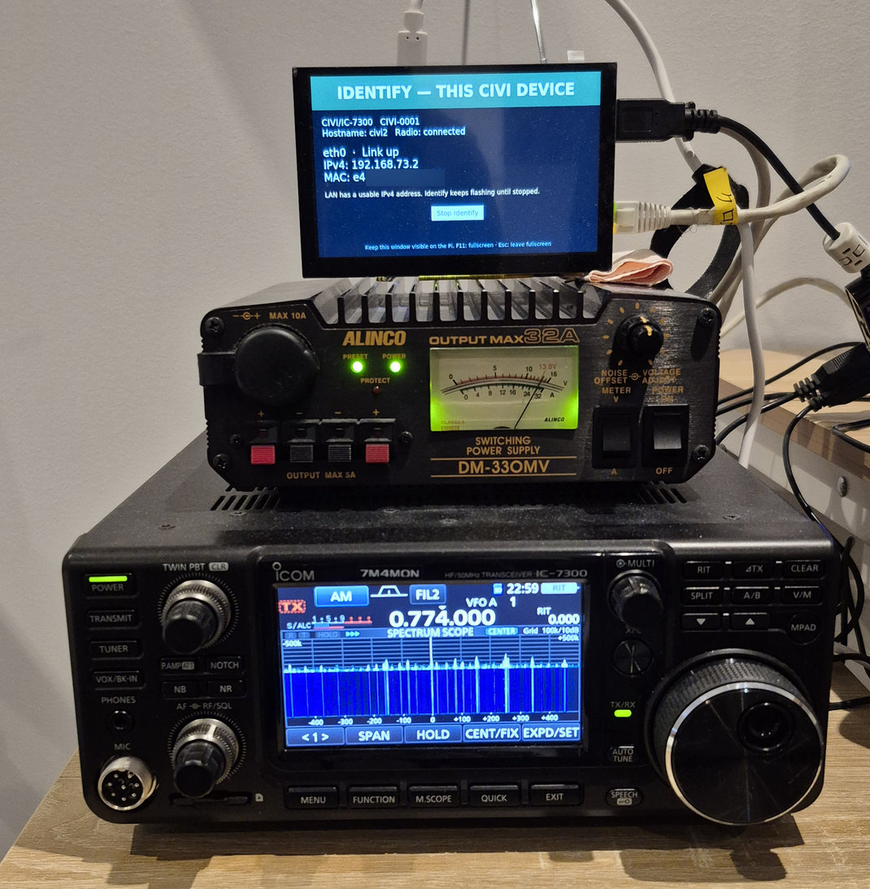

# CIVI

**English** | [日本語](README.ja.md) · Author: **7M4MON**

CIVI connects an **Icom IC-7300 to SCPI/VISA clients over LAN**. Attach the radio by USB to Windows or a Raspberry Pi 4, then use the English web interface, typed Python driver or LabVIEW. TCP and HTTPS share one serialized CI-V control queue.

## Features

| Interface | Capabilities |
|---|---|
| SCPI / VISA | TCP 5025, LF framing, abbreviations, units, compound commands, errors, completion and receive-profile reset |
| Radio | VFO/frequency/mode, gains, filters, meters, memories, band stacks, keyer storage, scans, 475-point scope and menus |
| Python | Dedicated typed APIs for **all 339 extended CIVI definitions**, plus base commands; 43 public/returned types and 352 indexed entries |
| Web | HTTPS, command explorer, spectrum scope, connection recovery and saved authentication |
| Raspberry Pi | DHCP/AutoIP/static IPv4, hostname/DNS, confirm/rollback, discovery, local LAN RESET, POWER ON/LAN status and Identify |
| LabVIEW | VISA sessions, read/settings examples and frequency sweep with CSV export |

## Verification

IC-7300 MAIN 1.41/1.42 campaigns cover receiver controls, all 216 menu reads, VFOs, memory write/read/restore, band stacks, keyers, scope and scans. Pi tests cover network configuration, discovery, reboot retention, recovery and local indication.

- [Implemented requirements, procedures and final results](docs/IMPLEMENTATION_AND_TEST_RESULTS.md)
- [Verification completion plan and registration procedures](docs/IVI_6_1_COMPLETION_2026-11-12.md)

The recorded Windows regression run passed 619 tests with one Linux-only skip. Physical test conditions and artifact versions are recorded with each result.



## Windows quick start

Install Python 3.11 or later. In PowerShell:

```powershell
python -m venv .venv
.\.venv\Scripts\python.exe -m pip install -e '.[test]'
Copy-Item config.example.toml config.toml
.\.venv\Scripts\python.exe -m civi --make-cert certs --host 192.168.1.20
.\start.cmd
```

Replace `192.168.1.20` with the address/name clients will use; `localhost` is included automatically. Trust the generated certificate on each client or configure a CA-issued certificate in `config.toml`.

- Web: `https://localhost:8443` · SCPI: `localhost:5025`
- Web username: `admin`. The launcher requests a password on first use and reuses saved credentials thereafter. [Password changes and recovery](docs/WEB_PASSWORD.md).
- Serial: set `backend="civ"`, the port (for example `COM25`), address `0x94` and baud rate `115200` in `config.toml`. IC-7300 USB CI-V should be unlinked from REMOTE; use Auto or matching baud on the radio.

The Web interface starts even when the radio is powered off. Connection state and explicit recovery are shown in **CI-V connection settings**. TX/RX frames are logged to the terminal and authenticated Web log. Transmit start is disabled by default; operations obey configured permissions and time limits.

## Raspberry Pi

Follow [Pi installation](docs/PORTING.md) and [HTTPS 443 setup](docs/RPI_HTTPS.md), then run:

```bash
bash desktop.sh --install
```

The **CIVI** desktop icon starts the gateway, LAN helper and attached-display panel manually. Keep their terminals open and the panel visible. Enter any Linux/sudo password in the helper terminal. Use `/dev/serial/by-id/` for the radio. No automatic startup is installed.

## Drivers and documentation

- [Python installation and examples](drivers/civi-ic7300/README.md) · [public API](drivers/civi-ic7300/src/civi_ic7300/REFERENCE.md)
- [LabVIEW project and examples](labview/CIVI/README.md)
- [SCPI / VISA examples](docs/SCPI.md) · [complete command list](docs/COMMANDS.md)
- [LAN settings](docs/RPI_LAN_SETTINGS.md) · [Web passwords](docs/WEB_PASSWORD.md)
- [Architecture](docs/ARCHITECTURE.md) · [LXI device configuration](docs/LXI_DEVICE_CONFIGURATION.md) · [clause matrix](docs/LXI_REQUIREMENTS_2026-11-10.md)
- [Documentation index](docs/INDEX.md)

Run automated tests with `.\.venv\Scripts\python.exe -m pytest -q`. They use simulated radios and fake serial ports.

The [official IC-7300 CI-V supplement](https://www.icom.co.jp/support/manual/2557/) is the radio command reference. The vendor PDF is not redistributed.
